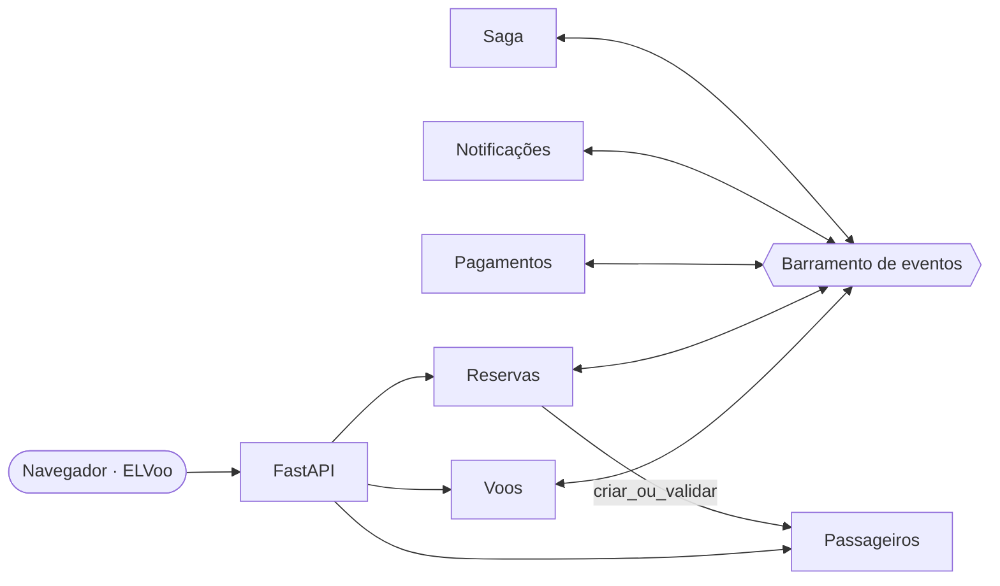
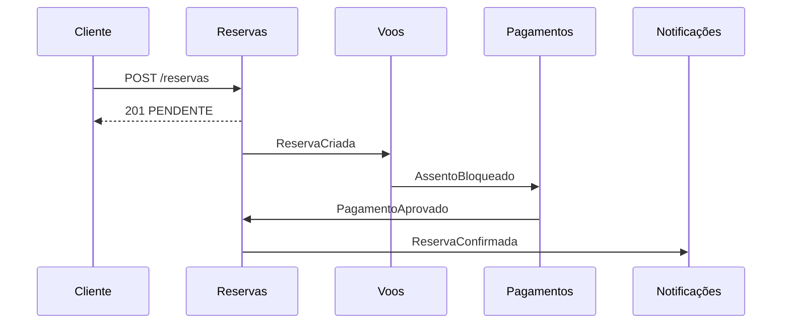

# Reservas Aéreas

Sistema de reservas de passagens aéreas construído como um **monólito modular
orientado a eventos**. A aplicação é única e simples de implantar, mas os
módulos são isolados: cada um tem as próprias tabelas e eles só se comunicam
por um barramento interno de eventos. O fluxo da reserva é coordenado por uma
**saga**, que desfaz os passos anteriores quando o assento está indisponível
ou o pagamento é recusado.

> Projeto acadêmico de **Francisco Erivelton** e **Liedson**. A interface web se chama **ELVoo** (**E**rivelton + **L**iedson + Voo).

## Objetivos

- Impedir que um mesmo assento seja vendido duas vezes, mesmo com requisições simultâneas.
- Manter a consistência entre módulos por meio de eventos e compensações.
- Isolar os módulos e proteger os dados pessoais dos passageiros.
- Validar as entradas e responder com erros HTTP previsíveis.
- Cobrir o comportamento com testes automatizados e implantar em nuvem.

## Equipe

| Integrante | Responsável por |
|---|---|
| **Francisco Erivelton** | Infraestrutura (banco, barramento de eventos, contratos e carregamento dos módulos), módulos **Voos** e **Reservas**, interface web **ELVoo**, fixture e testes, documentação dos contratos e implantação na **AWS** e na **Azure** |
| **Liedson** | Módulos **Passageiros** (cadastro e validação), **Pagamentos** (aprovação ou recusa), **Notificações** (avisos ao passageiro) e **Saga** (coordenação e compensações) |

## Arquitetura



| Módulo | Papel |
|---|---|
| `voos` | Cadastro de voos e assentos; bloqueio e liberação de assentos |
| `reservas` | Criação da reserva e estados `PENDENTE`, `CONFIRMADA` e `CANCELADA` |
| `passageiros` | Cadastro do passageiro; único módulo com dados pessoais |
| `pagamentos` | Processa o pagamento depois do bloqueio do assento |
| `notificacoes` | Avisa o passageiro sobre confirmação ou cancelamento |
| `saga` | Coordena o fluxo e dispara as compensações |

### Decisões de projeto

- **Sem venda dupla:** o assento é bloqueado com um único `UPDATE ... WHERE status = 'LIVRE'`. Se nenhuma linha muda, outra reserva chegou antes.
- **Publicação depois do commit:** nenhum evento anuncia algo que ainda pode ser desfeito por rollback.
- **Isolamento:** tabelas prefixadas pelo módulo e nenhuma chave estrangeira entre módulos.
- **Dados pessoais:** Reservas guarda só o `passageiro_id`; nome, documento e email ficam em Passageiros (minimização da LGPD).
- **Compensações idempotentes:** liberar um assento já livre ou cancelar uma reserva já cancelada não gera erro.
- **Sem consultas N+1:** a listagem de voos conta os assentos livres em uma única consulta agrupada.

## Fluxo da reserva



| Falha | Compensação da Saga | Resultado |
|---|---|---|
| `AssentoIndisponivel` | `CancelarReserva` | Reserva cancelada |
| `PagamentoRecusado` | `LiberarAssento` + `CancelarReserva` | Assento livre e reserva cancelada |

### Eventos

| Evento | Publicado por | Consumido por |
|---|---|---|
| `ReservaCriada` | Reservas | Voos |
| `AssentoBloqueado` / `AssentoIndisponivel` | Voos | Pagamentos / Saga |
| `PagamentoAprovado` / `PagamentoRecusado` | Pagamentos | Reservas / Saga |
| `ReservaConfirmada` / `ReservaCancelada` | Reservas | Notificações |
| `LiberarAssento` / `CancelarReserva` | Saga | Voos / Reservas |

Campos e regras completas: [`docs/CONTRATOS.md`](docs/CONTRATOS.md).

## Tecnologias

Python 3.12+ · FastAPI · Pydantic · SQLAlchemy 2 · SQLite · pytest · HTML, CSS e JavaScript · AWS · Azure

## Como executar

```bash
git clone https://github.com/EriveltonJr/reservas-aereas.git
cd reservas-aereas
python -m venv .venv
.venv\Scripts\activate          # Linux/macOS: source .venv/bin/activate
pip install -r requirements.txt
python -m uvicorn app.main:criar_app --factory --reload
```

| Endereço | O que é |
|---|---|
| **http://127.0.0.1:8000/** | Interface web ELVoo |
| **http://127.0.0.1:8000/docs** | Documentação interativa da API (Swagger) |

O banco padrão é o arquivo `reservas.db`. Para usar outro, defina
`RESERVAS_DATABASE_URL`.

## Interface web

A página fica em [`app/web/index.html`](app/web/index.html), em um único arquivo
com HTML, CSS e JavaScript, sem bibliotecas. Ela usa apenas as rotas da API.

- Números ao vivo: voos, assentos livres e destinos.
- Busca por origem, destino e preço máximo.
- Mapa da cabine para escolher o assento; os ocupados ficam bloqueados.
- Formulário do passageiro com as mesmas validações da API.
- Bilhete da reserva com o status, atualizado automaticamente enquanto estiver `PENDENTE`.
- Consulta de reserva pelo número, com as reservas recentes salvas no navegador.
- Área de demonstração para cadastrar voos.

## API

| Método | Rota | Descrição |
|---|---|---|
| `POST` | `/voos` | Cria voo e assentos |
| `GET` | `/voos` | Lista voos com assentos livres |
| `GET` | `/voos/{id}` | Detalha voo e status dos assentos |
| `POST` | `/reservas` | Cria reserva `PENDENTE` |
| `GET` | `/reservas/{id}` | Consulta reserva |

Erros: `404` não encontrado, `409` duplicado, `422` entrada inválida.

```json
POST /reservas
{
  "voo_id": 1,
  "assento": "1A",
  "passageiro": { "nome": "Ana Souza", "documento": "12345", "email": "ana@exemplo.com" }
}
```

A resposta traz `id`, `status` e `passageiro_id`, sem nome, documento ou email.

## Testes

```bash
python -m pytest -v
```

A fixture `sistema("modulo")`, em `tests/conftest.py`, monta a aplicação só com
os módulos pedidos, usa um SQLite temporário e permite publicar eventos e
conferir os que foram gerados.

| Arquivo | Cobre |
|---|---|
| `test_infraestrutura.py` | Sessões, barramento, contratos e carregamento de módulos |
| `test_voos.py` | Cadastro, validação, bloqueio, assento ocupado e liberação |
| `test_reservas.py` | Criação, dados pessoais, confirmação e cancelamento |
| `test_web.py` | Entrega da interface web |

## Estrutura

```
app/
├── main.py         # criar_app()
├── banco.py        # engine e sessões
├── barramento.py   # barramento de eventos
├── contratos.py    # container e contratos entre módulos
├── eventos.py      # eventos de domínio
├── modulos/        # voos, reservas, passageiros, pagamentos, notificacoes, saga
└── web/index.html  # interface ELVoo
docs/CONTRATOS.md
tests/
```

## Situação

| Etapa | Responsável | Situação |
|---|---|---|
| Infraestrutura, Voos e Reservas | Erivelton | Concluído (`base-v1`) |
| Interface web ELVoo | Erivelton | Concluída |
| Passageiros, Pagamentos, Notificações e Saga | Liedson | Em desenvolvimento |
| Implantação AWS e Azure | Erivelton | Planejada |

## Referências

- GARCIA-MOLINA, H.; SALEM, K. **Sagas**. ACM SIGMOD, 1987.
- RICHARDSON, C. **Microservices Patterns**. Manning, 2018.
- EVANS, E. **Domain-Driven Design**. Addison-Wesley, 2003.
- FOWLER, M. **MonolithFirst**. martinfowler.com, 2015.
- BRASIL. **Lei nº 13.709/2018** (LGPD).
