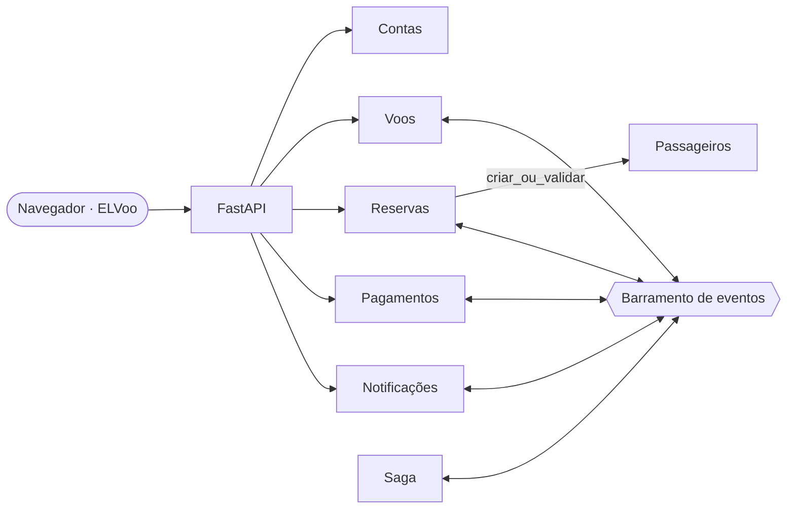
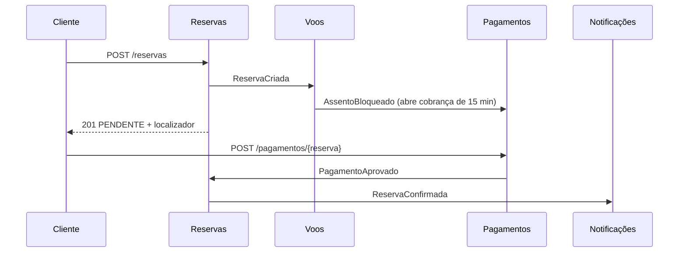

# Reservas Aéreas

Sistema de reservas de passagens aéreas construído como um **monólito modular
orientado a eventos**. A aplicação é única e simples de implantar, mas os
módulos são isolados: cada um tem as próprias tabelas e eles só se comunicam
por um barramento interno de eventos. O fluxo da reserva é coordenado por uma
**saga**, que desfaz os passos anteriores quando o assento está indisponível,
o prazo de pagamento expira ou o cliente cancela.

O site tem contas de cliente e de administrador, pagamento com cartão simulado,
notificações por conta e regras inspiradas em companhias aéreas reais: prazo
para pagar, cancelamento gratuito em 24 horas, estorno e encerramento das
vendas antes da partida.

> Projeto acadêmico de **Francisco Erivelton** e **Liedson**. A interface web se chama **ELVoo** (**E**rivelton + **L**iedson + Voo).

## Objetivos

- Impedir que um mesmo assento seja vendido duas vezes, mesmo com requisições simultâneas.
- Manter a consistência entre módulos por meio de eventos e compensações.
- Isolar os módulos e proteger os dados pessoais dos passageiros.
- Validar as entradas e responder com erros HTTP previsíveis.
- Proteger contas e dados com boas práticas de segurança (senhas com hash, sessão HttpOnly, CSRF, controle de acesso).
- Cobrir o comportamento com testes automatizados e implantar em nuvem.

## Equipe

| Integrante | Responsável por |
|---|---|
| **Francisco Erivelton** | Infraestrutura (banco, barramento de eventos, contratos e carregamento dos módulos), módulos **Contas** (login, cadastro e segurança), **Voos** e **Reservas**, checkout de pagamento, interface web **ELVoo**, fixture e testes, documentação dos contratos e implantação na **AWS** e na **Azure** |
| **Liedson** | Módulos **Passageiros** (cadastro e validação), **Pagamentos** (aprovação ou recusa), **Notificações** (avisos ao passageiro) e **Saga** (coordenação e compensações) |

## Arquitetura



| Módulo | Papel |
|---|---|
| `contas` | Cadastro, login, sessão e papéis de cliente e administrador |
| `voos` | Voos com horários, assentos e preço; bloqueio e liberação de assentos |
| `reservas` | Reserva com localizador, estados `PENDENTE`, `CONFIRMADA` e `CANCELADA` e política de cancelamento |
| `passageiros` | Cadastro do passageiro; único módulo com dados pessoais do passageiro |
| `pagamentos` | Cobrança com prazo, checkout com cartão simulado, expiração e estorno |
| `notificacoes` | Avisos na conta do cliente e avisos operacionais para o administrador |
| `saga` | Coordena as compensações: libera o assento e cancela a reserva |

### Decisões de projeto

- **Sem venda dupla:** o assento é bloqueado com um único `UPDATE ... WHERE status = 'LIVRE'`. Se nenhuma linha muda, outra reserva chegou antes.
- **Publicação depois do commit:** nenhum evento anuncia algo que ainda pode ser desfeito por rollback.
- **Isolamento:** tabelas prefixadas pelo módulo e nenhuma chave estrangeira entre módulos.
- **Dados pessoais:** Reservas guarda só o `passageiro_id`; nome, documento e email ficam em Passageiros (minimização da LGPD).
- **Compensações idempotentes:** liberar um assento já livre ou cancelar uma reserva já cancelada não gera erro.
- **Sem consultas N+1:** a listagem de voos conta os assentos livres em uma única consulta agrupada.
- **Pagamento seguro:** do cartão só ficam a bandeira e os 4 últimos dígitos; número completo e CVV nunca são gravados.

## Fluxo da reserva



| Falha | Compensação da Saga | Resultado |
|---|---|---|
| `AssentoIndisponivel` | `CancelarReserva` | Reserva cancelada |
| `PrazoPagamentoExpirado` | `LiberarAssento` + `CancelarReserva` | Assento livre e reserva cancelada |
| `CancelamentoSolicitado` | `LiberarAssento` + `CancelarReserva` | Assento livre, reserva cancelada e estorno se já paga |

Um cartão recusado (`PagamentoRecusado`) não cancela a reserva: o cliente pode
tentar de novo até o fim do prazo.

### Eventos

| Evento | Publicado por | Consumido por |
|---|---|---|
| `ReservaCriada` | Reservas | Voos, Pagamentos, Notificações |
| `AssentoBloqueado` / `AssentoIndisponivel` | Voos | Pagamentos / Saga |
| `PagamentoAprovado` / `PagamentoRecusado` | Pagamentos | Reservas / Notificações |
| `PrazoPagamentoExpirado` / `PagamentoEstornado` | Pagamentos | Saga / Notificações |
| `ReservaConfirmada` / `ReservaCancelada` | Reservas | Notificações, Pagamentos |
| `CancelamentoSolicitado` | Reservas | Saga |
| `LiberarAssento` / `CancelarReserva` | Saga | Voos / Reservas |

Campos e regras completas: [`docs/CONTRATOS.md`](docs/CONTRATOS.md).

## Tecnologias

Python 3.12+ · FastAPI · Pydantic · SQLAlchemy 2 · SQLite · pytest · HTML, CSS e JavaScript · AWS · Azure

## Como executar

```bash
git clone https://github.com/EriveltonJr/reservas-aereas.git
cd reservas-aereas
python -m venv .venv
.venv\Scripts\activate          # Linux/macOS: source .venv/bin/activate
pip install -r requirements.txt
python -m app.modulos.contas criar-admin seu-email@dominio.com --nome "Seu Nome"
python -m uvicorn app.main:criar_app --factory --reload
```

| Endereço | O que é |
|---|---|
| **http://127.0.0.1:8000/** | Interface web ELVoo |
| **http://127.0.0.1:8000/docs** | Documentação interativa da API (Swagger) |

O comando `criar-admin` pede a senha no terminal (ela não fica em arquivo
nenhum). Clientes criam a conta pelo próprio site.

O banco padrão é o arquivo `reservas.db`. Para usar outro, defina
`RESERVAS_DATABASE_URL`. Se você tinha um `reservas.db` de uma versão anterior,
apague-o antes de subir: as tabelas mudaram.

## Interface web

O site fica em [`app/web/`](app/web/) (`index.html`, `estilo.css`, `app.js` e
fotos), em HTML, CSS e JavaScript, sem bibliotecas.

- **Página inicial:** carrossel de destaques, busca por origem, destino e data, voos com horários e duração, destinos em destaque e vantagens.
- **Entrar e criar conta:** indicador de força da senha, mostrar ou ocultar senha e aceite dos termos e da política de privacidade.
- **Compra:** mapa da cabine, dados do passageiro e checkout com cronômetro de 15 minutos e cartão simulado (há cartões de teste na própria tela).
- **Área do cliente:** reservas com status, pagamento pendente, bilhete com localizador e cancelamento dentro da política.
- **Notificações:** sino com contador e avisos de reserva criada, confirmada e cancelada.
- **Painel do administrador:** métricas, cadastro de voos, alteração de preços, reservas, pagamentos e avisos de pagamento recebido, recusado e estorno.
- **Políticas:** tarifas, cancelamento e reembolso, bagagem, embarque, privacidade (LGPD) e termos.

## Segurança

- Senhas com hash `scrypt` e sal aleatório; nunca são devolvidas pela API.
- Sessão em cookie `HttpOnly` e `SameSite=Strict`, com validade de 8 horas.
- Proteção contra CSRF: alterações exigem o cabeçalho `X-Requested-With`.
- Bloqueio de 15 minutos após 5 tentativas de login erradas, com mensagem que não revela se o e-mail existe.
- Cada cliente só acessa as próprias reservas, pagamentos e notificações; rotas de administração exigem o papel `ADMIN`.
- Cabeçalhos de segurança: Content-Security-Policy, X-Frame-Options, X-Content-Type-Options e Referrer-Policy.

## API

| Método | Rota | Acesso | Descrição |
|---|---|---|---|
| `POST` | `/auth/cadastro`, `/auth/entrar`, `/auth/sair` | público | Conta e sessão |
| `GET` | `/voos`, `/voos/{id}` | público | Voos à venda e mapa de assentos |
| `POST`, `PATCH` | `/voos`, `/voos/{id}` | admin | Cadastrar voo e alterar preço |
| `POST`, `GET` | `/reservas`, `/reservas/{id}` | cliente | Reservar e consultar |
| `POST` | `/reservas/{id}/cancelar` | cliente | Cancelar conforme a política |
| `POST`, `GET` | `/pagamentos/{reserva_id}` | cliente | Pagar e consultar a cobrança |
| `GET` | `/notificacoes` | cliente | Avisos da conta |

Erros: `401` sem login, `402` cartão recusado, `403` sem permissão, `404` não
encontrado, `409` conflito, `422` entrada inválida e `429` excesso de
tentativas. Detalhes em [`docs/CONTRATOS.md`](docs/CONTRATOS.md).

## Testes

```bash
python -m pytest -v
```

A fixture `sistema("modulo")`, em `tests/conftest.py`, monta a aplicação só com
os módulos pedidos, usa um SQLite temporário e permite publicar eventos e
conferir os que foram gerados.

| Arquivo | Cobre |
|---|---|
| `test_infraestrutura.py` | Sessões, barramento, contratos e carregamento de módulos |
| `test_contas.py` | Cadastro, login, logout, bloqueio por tentativas, CSRF e hash de senha |
| `test_voos.py` | Cadastro pelo admin, preço, validação, vendas encerradas e assentos |
| `test_reservas.py` | Login obrigatório, isolamento entre clientes, confirmação e cancelamento |
| `test_pagamentos.py` | Cartão aprovado e recusado, validação, prazo expirado e estorno |
| `test_saga.py` / `test_notificacoes.py` | Compensações e avisos por conta e para o admin |
| `test_fluxo_completo.py` | Compra, cancelamento e expiração com todos os módulos |
| `test_web.py` | Entrega da interface web |

## Estrutura

```
app/
├── main.py         # criar_app()
├── banco.py        # engine e sessões
├── barramento.py   # barramento de eventos
├── contratos.py    # container e contratos entre módulos
├── eventos.py      # eventos de domínio
├── politicas.py    # regras da companhia (prazos e limites)
├── seguranca.py    # senhas, sessão, permissões e cabeçalhos
├── modulos/        # contas, voos, reservas, passageiros, pagamentos, notificacoes, saga
└── web/            # interface ELVoo (index.html, estilo.css, app.js e img/)
docs/CONTRATOS.md
tests/
```

## Situação

| Etapa | Responsável | Situação |
|---|---|---|
| Infraestrutura, Voos e Reservas | Erivelton | Concluído (`base-v1`) |
| Interface web ELVoo | Erivelton | Concluída |
| Contas, segurança, checkout e painel do admin | Erivelton | Concluído |
| Passageiros, Pagamentos, Notificações e Saga | Liedson | Concluída |
| Implantação AWS | Erivelton | Concluída |

## Referências

- GARCIA-MOLINA, H.; SALEM, K. **Sagas**. ACM SIGMOD, 1987.
- RICHARDSON, C. **Microservices Patterns**. Manning, 2018.
- EVANS, E. **Domain-Driven Design**. Addison-Wesley, 2003.
- FOWLER, M. **MonolithFirst**. martinfowler.com, 2015.
- BRASIL. **Lei nº 13.709/2018** (LGPD).
